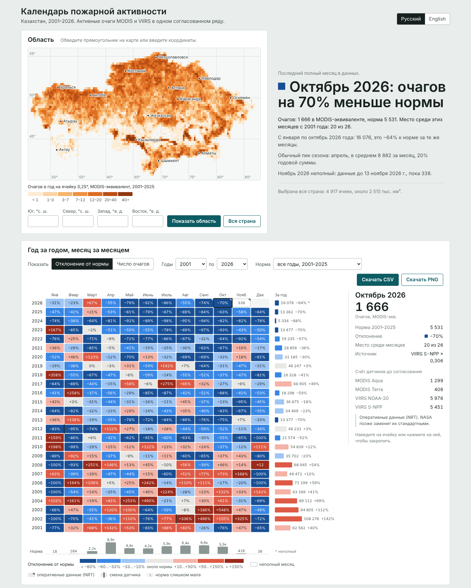

# Календарь пожарной активности / Fire activity calendar

Веб-приложение для NASA Space Apps Challenge 2026, задача «MODIS and VIIRS Hot Spots».
Оно сводит активные очаги MODIS (с 2000 года) и VIIRS (с 2012 года) из NASA FIRMS в один
согласованный ряд и показывает его как календарь «год × месяц» для выбранной области Казахстана.



## Что умеет

- Выбор области: прямоугольник на карте или координаты.
- Календарь по месяцам: отклонение от многолетней нормы или число очагов.
- Вывод по последнему полному месяцу: насколько он отличается от нормы и какое место занимает.
- Норма на выбор: все годы, последние 10 лет, годы VIIRS.
- Карточка месяца: значение, норма, место, источник, счёт каждого датчика до согласования.
- Проверка согласования для выбранной области: MODIS и пересчитанный VIIRS в общие годы.
- Выгрузка CSV и PNG. Интерфейс на русском и английском.

## Как открыть

Откройте `index.html` двойным щелчком. Сервер и интернет не нужны: данные лежат в
`data/processed/grid.js`, шрифты системные.

Для публикации включите GitHub Pages для ветки `main` (Settings → Pages).

## Как пересчитать данные

1. Скачайте архив по Казахстану на https://firms.modaps.eosdis.nasa.gov/download/ в формате CSV:
   MODIS, VIIRS S-NPP, VIIRS NOAA-20.
2. Положите CSV в `data/raw/` (папка не хранится в Git).
3. Запустите из корня проекта:

   ```
   pip install pandas
   python scripts/aggregate.py
   ```

Скрипт пишет `data/processed/grid.json` и его копию `grid.js`, которую читает приложение.

## Метод

- Сетка 0,25° по месяцам.
- Отбор: MODIS с достоверностью от 30, VIIRS без категории «низкая». Убраны статичные источники
  тепла по полю `type` FIRMS и участки 0,05°, где они повторяются (газовые факелы, заводы).
- Все числа приведены к уровню MODIS Terra + Aqua:
  - до июля 2002 года работал только Terra, его счёт умножается на 2,05;
  - с августа 2002 по январь 2012 года берётся MODIS Terra + Aqua;
  - с февраля 2012 года берётся VIIRS S-NPP × 0,306;
  - ряд S-NPP в выгрузке заканчивается 2 ноября 2026 года, дальше берётся NOAA-20 × 0,306.
- Коэффициенты: отношение сумм очагов по стране за общие месяцы. Для S-NPP это 174 месяца,
  корреляция месячных рядов 0,98, по годам отношение от 0,26 до 0,34.
- Норма: среднее согласованного ряда для каждого календарного месяца. Отклонение: отношение
  месяца к норме. При норме меньше 2 очагов отклонение не считается.

Точные значения коэффициентов лежат в `grid.json`, раздел `meta.calibration`.

## Ограничения

- Коэффициент один на всю страну. В отдельных областях он отличается, это видно в блоке проверки.
- Спутник не видит очаги под облаками и между пролётами. Очаг не равен подтверждённому пожару.
- Последние месяцы построены на оперативных данных (NRT), позже NASA заменяет их стандартными.
- Разрешение ограничено сеткой 0,25°. Покрытие: только Казахстан.

## Структура

```
index.html            страница
css/style.css         оформление
js/core.js            расчёты: согласованный ряд, норма, отклонения, CSV
js/app.js             интерфейс: карта, календарь, графики
js/i18n.js            тексты на русском и английском
scripts/aggregate.py  подготовка данных из CSV FIRMS
data/processed/       готовая сетка (grid.json, grid.js)
```

## Источник данных

NASA FIRMS: MODIS Collection 6.1 (MCD14ML, MCD14DL) и VIIRS 375 m Collection 2
(VNP14IMGT, VJ114IMGT). Проект не является продуктом NASA.
